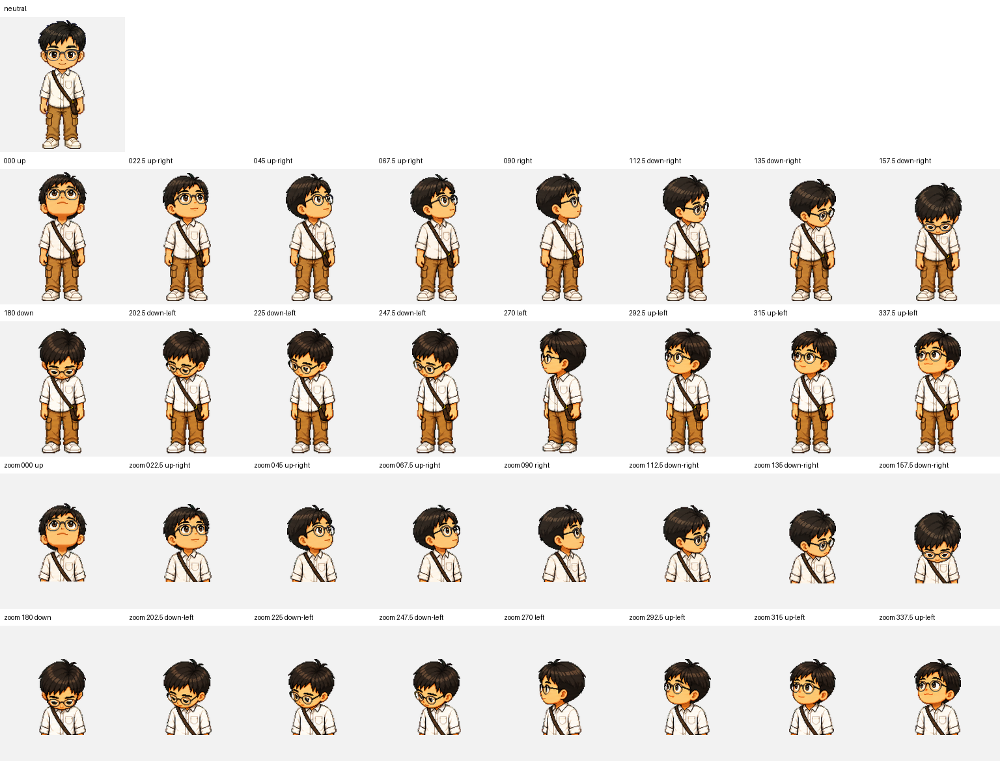

# pixel-intern · 像素实习生

戴银灰方框眼镜、背斜挎包的像素实习生，陪你一起完成 Codex 任务。

Pixel Intern is an AI-assisted pixel-art companion with silver-gray glasses and a crossbody satchel.

[](https://petdex.dev/pets/pixel-intern)
[](LICENSE)

## Petdex

像素实习生已于 **2026 年 10 月 26 日上线 Petdex**。

**[在 Petdex 查看像素实习生](https://petdex.dev/pets/pixel-intern)**

## 动画预览

| 待机 | 向右跑 | 向左跑 |
| --- | --- | --- |
|  |  |  |
| 挥手 | 跳跃 | 失败 |
|  |  |  |
| 等待确认 | 执行任务 | 检查 |
|  |  |  |

### 16 个看向方向



## 当前版本

本仓库提供最终 **V2 优化版**：九种动画状态，加上十六个看向方向。保留初版动画，新增方向帧，修正上下左右方向，并处理边缘色溢。

| 项目 | 值 |
| --- | --- |
| 宠物 ID | `pixel-intern` |
| 图集布局版本 | `spriteVersionNumber: 2` |
| 格式 | 透明 RGBA WebP |
| 尺寸 | 1536 × 2288 |
| 网格 | 8 列 × 11 行 |
| 单帧尺寸 | 192 × 208 |

`v1.0.0` 是仓库的首次公开发布版本；`spriteVersionNumber: 2` 是图集布局版本，两者含义不同。

发布前已核对本地安装包、最终优化包和 Petdex 下载包，精灵图 SHA-256 一致：

```text
07da9082ef4cc43e7b98980f6acccb14c44e7d194c28e19a87d3307c60d28201
```

已有制作检查记录通过图集、透明度和方向检查。部分动作仍使用较明显的逐帧切换，少数中间方向的朝向提示较轻微。

## 使用与署名

按 [MIT 许可证](LICENSE) 开放使用、修改和分发，允许商业使用；分发时保留许可证和版权声明。

这是 AI 辅助制作的自定义像素角色。发布者：[@CaiusLuo](https://github.com/CaiusLuo)。项目与 OpenAI、Codex 和 Petdex 无官方关联。详见 [制作说明](CREDITS.md) 和 [版本记录](CHANGELOG.md)。
